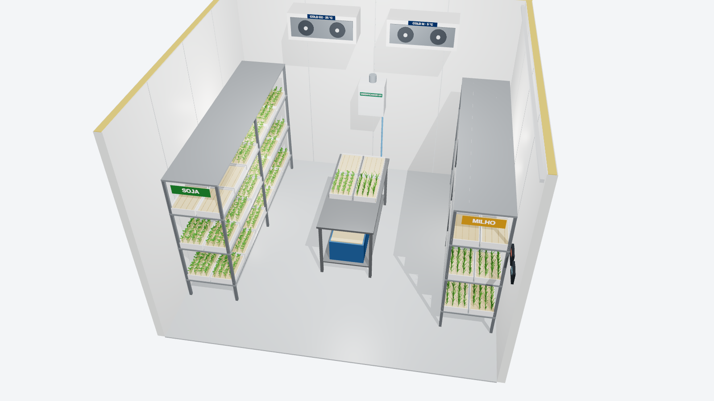

# Sala de Germinação Areia/Frio — 3D 360°

Modelo 3D interativo da sala de teste de emergência em areia (soja e milho) e teste de frio em milho.

**Abrir no navegador:** https://edsonleandrojorge.github.io/Sala-de-Germina-o-Areia-Frio/

## Como usar
- **360° interno:** arraste para olhar em volta; roda do mouse ou pinça para zoom.
- **Vista externa:** arraste para girar a sala em corte.
- Botões para pausar o giro automático e ocultar os rótulos.

## Layout
- Sala: 4,36 × 4,26 × 3,22 m, isopainel PIR 100 mm
- Porta no centro da parede dos equipamentos de refrigeração (Cold G2 25 °C e Cold M 5 °C)
- 5 estantes de 3 níveis: 126 bandejas (≈ 63 amostras de 2 × 100 sementes por ciclo)
- Bancada inox central de semeadura

*Ilustração conceitual — medidas finais conforme projeto executivo.*
